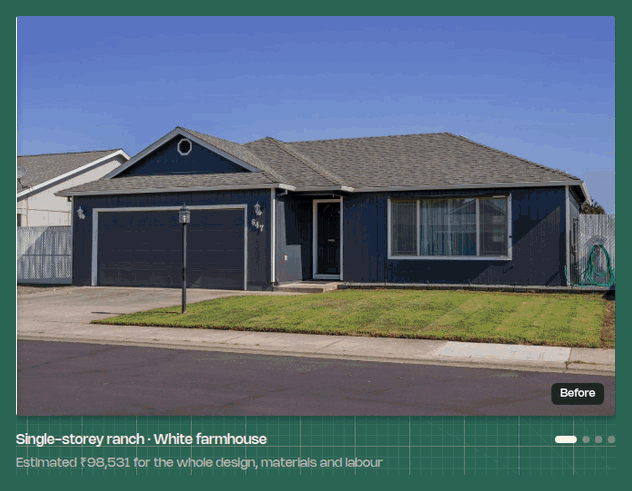
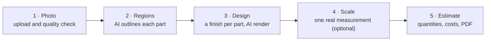
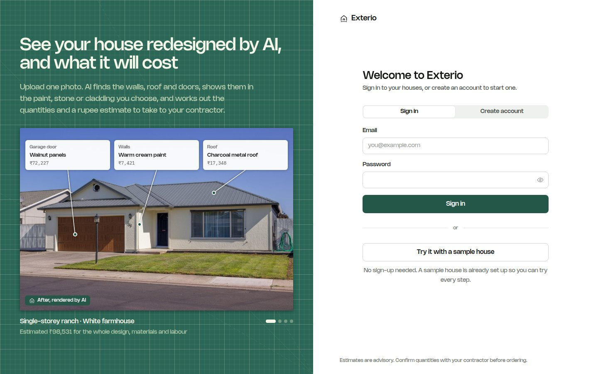
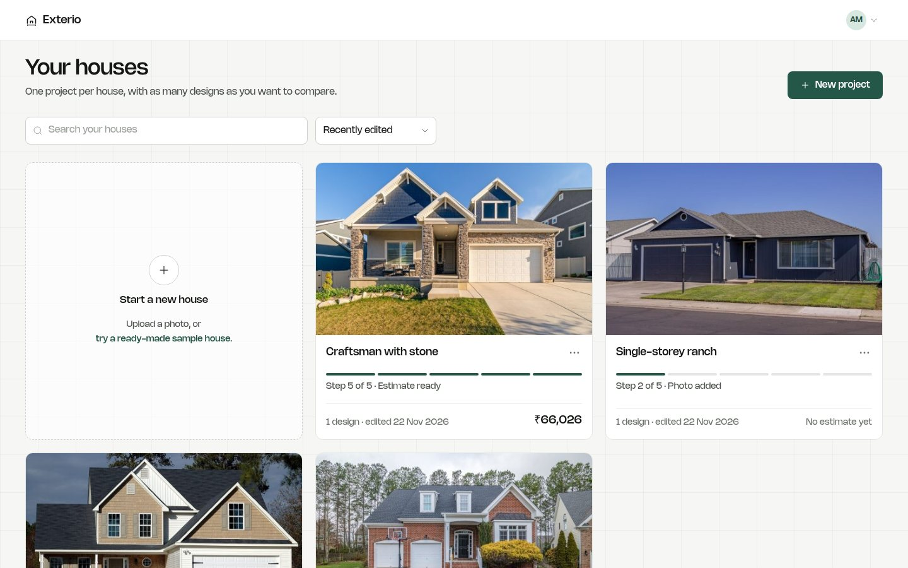
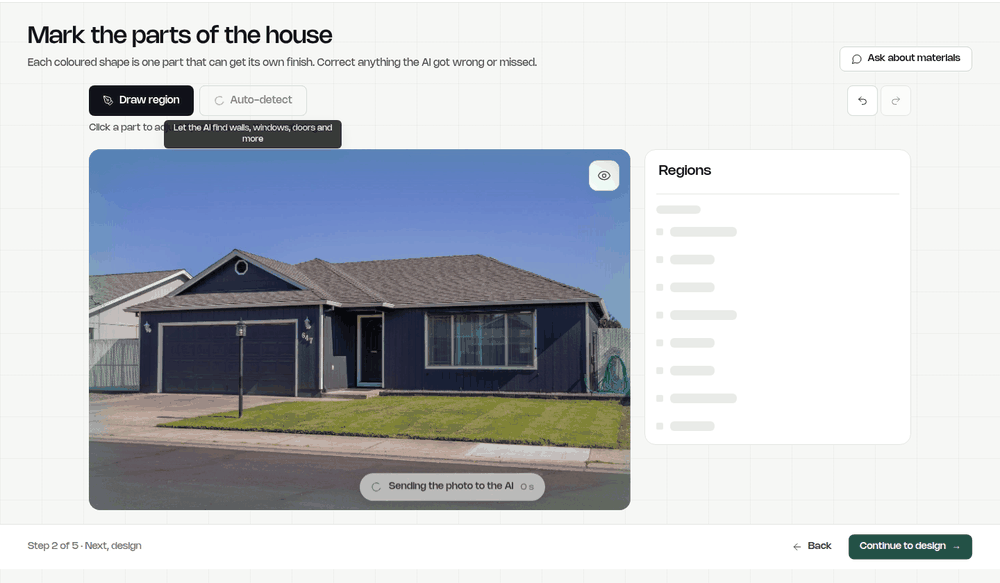
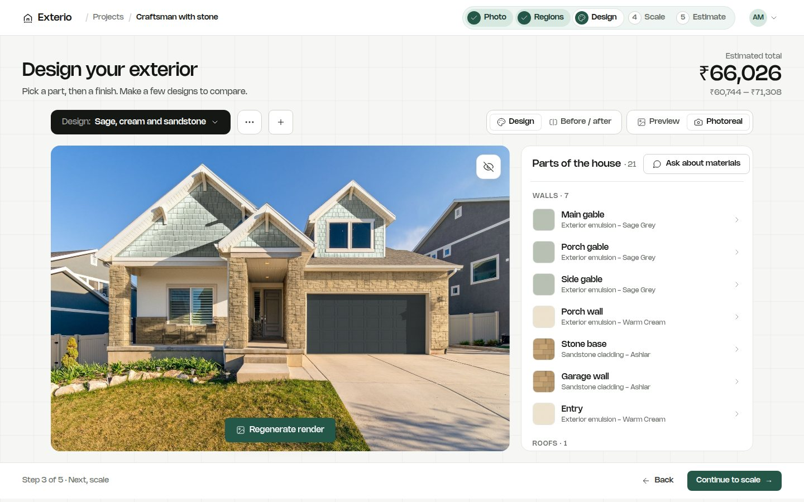
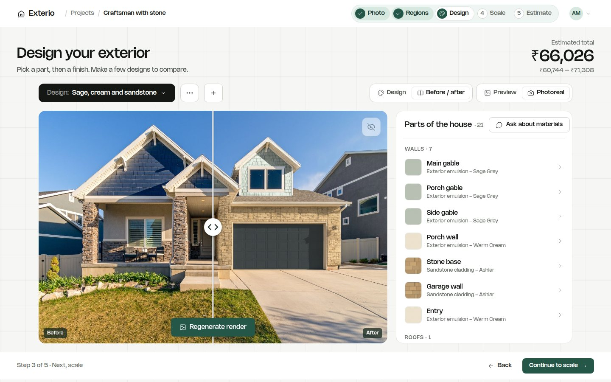
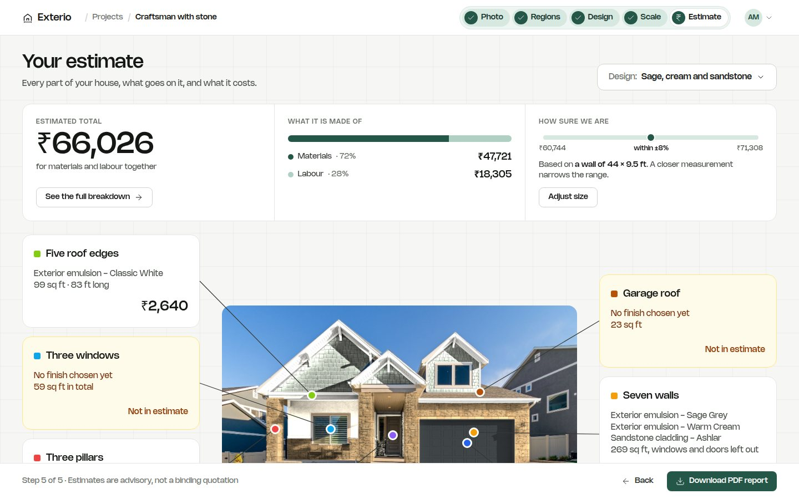
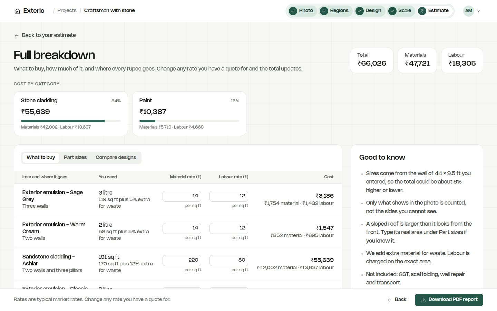
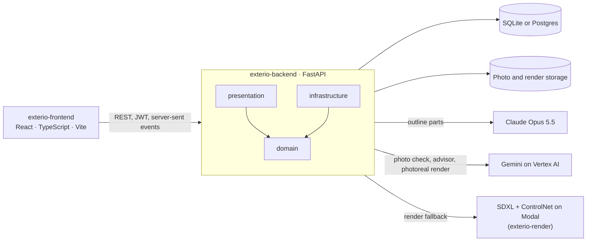

<div align="center">

# Exterio

**See your house redesigned by AI, and what it will cost.**

[](https://github.com/DharmikGohil/exterio/actions/workflows/ci.yml)


**[Live demo](https://exterio.dharmikgohil.in)** ·
[How it works](#how-it-works) ·
[Screenshots](#screenshots) ·
[Quick start](#quick-start) ·
[Architecture](#architecture) ·
[Documentation](#documentation)



Upload one photo of a house. AI finds the walls, roof, windows, pillars and railings; you choose
paint, stone, tiles or cladding for each part; Exterio renders the redesign on your own house and
works out the quantities and a rupee estimate you can take to a contractor.

</div>

---

## Why Exterio

Homeowners planning an exterior renovation decide on wall cladding, texture paint, tiles and
railings from brochures, not from their own house. Contractors measure by eye, wastage is a
guess and labour is a single number. Exterio is a **pre-construction planning assistant**: it
shows the redesign on the actual house and explains every rupee of the estimate before any work
starts.

- **Your own house, redesigned.** An instant preview paints each finish onto its part of the photo;
  an AI photoreal render then makes it look real, while the rest of the photo stays untouched.
- **AI does the tedious part.** Auto-detect outlines every part of the facade and draws each one
  on the photo the moment the AI finds it. Every outline can be reshaped, relabelled or undone.
- **Numbers you can check.** Perspective-corrected areas, quantities with wastage and coverage,
  material and labour per line, per category and in total, with a stated confidence band.
- **Built for a contractor conversation.** Edit any rate you have a quote for, compare designs,
  and download a PDF with both images, the quantities and the costs.

## How it works



| Step | You | Exterio |
|---|---|---|
| **1. Photo** | Upload a JPG, PNG or WebP of the house front | Shrinks it in the browser, fixes orientation, checks sharpness, light and size, and asks a vision model whether it is a usable house exterior. Bad photos are rejected with tips for a retake |
| **2. Regions** | Press Auto-detect, then fix anything wrong | Streams each detected part onto the photo as the AI writes it: walls, roofs, windows, doors, balconies, pillars, parapets, railings, gates, roof edges and named extras. Reshape, relabel, add, delete, undo |
| **3. Design** | Pick a finish for each part; save several designs | Re-renders the instant preview in under a second; on request, a photoreal AI render with a before / after slider |
| **4. Scale** | Optionally give one real size (wall, a known length, a door or the number of floors) | Removes perspective and converts pixels to square feet. Skipped, it assumes a storey height and labels the estimate rough |
| **5. Estimate** | Review, edit rates or areas, download the PDF | Net area, wastage, purchase quantity (litres, whole tiles, sq ft, running ft), material and labour cost, per-category and grand totals |

A **material advisor** is available on every step: a retrieval-augmented chat that answers
questions about finishes, durability and cost using the house's own measured figures.

## Screenshots

<table>
  <tr>
    <td width="50%"><br/><sub><b>Sign in</b>, or try a ready-made sample house without an account</sub></td>
    <td width="50%"><br/><sub><b>Your houses</b>, each with its progress and latest estimate</sub></td>
  </tr>
  <tr>
    <td colspan="2"><br/><sub><b>Auto-detect, live.</b> Each part appears on the photo and in the list the moment the AI has written it</sub></td>
  </tr>
  <tr>
    <td><br/><sub><b>Design</b>: the AI photoreal render of the chosen finishes</sub></td>
    <td><br/><sub><b>Before / after</b>: compare the redesign with the original photo</sub></td>
  </tr>
  <tr>
    <td><br/><sub><b>Estimate</b>: the total, what it is made of, how sure it is, every part priced on the house</sub></td>
    <td><br/><sub><b>Full breakdown</b>: cost by category, what to buy, editable rates</sub></td>
  </tr>
</table>

## Architecture

Everything is derived from **one list of labelled region polygons**. The redesigned image and the
cost estimate are both computed from those regions, so they cannot drift apart, and fixing a
region fixes both at once.



- **Clean, layered code.** Both apps follow `domain → infrastructure → presentation`. The
  backend's layer rules are enforced in CI by `import-linter`; the domain imports no framework.
- **Two-tier rendering.** Trying a material is an instant, free OpenCV composite. The AI render is
  an explicit action that starts from that composite, and the original pixels are pasted back
  outside the refinished parts, so the building's structure is preserved by construction.
- **Swappable AI providers.** Each AI task sits behind a small interface with fallbacks, so a model
  can be replaced in one file plus one line in the registry.

Details: [docs/ARCHITECTURE.md](docs/ARCHITECTURE.md).

### Which model does what, and why

Each job goes to the model that **measured** best at it, among those configured:

| Task | Model | Why |
|---|---|---|
| Outlining parts (Auto-detect) | Claude Opus 5.5 | On the four hand-traced sample houses it matched the traced walls with IoU 0.87 to 0.88, against 0.84 for Sonnet 5.5, 0.86 for Haiku 5.5 and 0.78 for Gemini 3.1 Pro |
| Photoreal render | Gemini 2.5 Flash Image, falling back to SDXL + ControlNet on Modal | Gemini looked clearly more realistic (real metal roofs, painted brick, light); Modal takes over if Gemini is busy or fails |
| Photo check and advisor | Gemini 3 Flash | Answers in a few seconds and streams the advice word by word |

The benchmark is reproducible: `scripts/benchmark_detection.py` (results and raw detections in
[docs/LIMITATIONS.md](docs/LIMITATIONS.md#choosing-the-detection-model) and
[docs/benchmarks](docs/benchmarks)).

## Tech stack

| Layer | Technology |
|---|---|
| Web app | React 18, TypeScript 5.9, Vite 6, Tailwind CSS 3, TanStack Query 5, Vitest |
| API | Python 3.12, FastAPI, Pydantic 2, SQLAlchemy 2, uv |
| Imaging and measurement | OpenCV, NumPy (quality checks, homography, pixel areas, compositing) |
| Reports | ReportLab, pandas |
| AI | Claude (Anthropic SDK), Gemini on Vertex AI (google-genai), SDXL + ControlNet on Modal |
| Quality | ruff, mypy (strict), import-linter, pytest, ESLint, Prettier, GitHub Actions |

## Quick start

**Requirements:** [uv](https://docs.astral.sh/uv/) and Node 22 or newer.

```bash
git clone https://github.com/DharmikGohil/exterio.git
cd exterio
```

Start the API (port 8000):

```bash
cd exterio-backend && cp .env.example .env && uv sync && make dev
```

Start the web app (port 5173) in a second terminal:

```bash
cd exterio-frontend && cp .env.example .env && npm install && npm run dev
```

Open http://localhost:5173 and press **Try it with a sample house**. It signs in to the demo
account (`demo@example.com` / `review-2026` by default), which holds four sample houses at
different stages, so every step can be tried at once. The API docs are at
http://localhost:8000/api/docs.

> [!TIP]
> No API keys are needed to run the whole flow: regions can be drawn by hand and the instant
> preview covers every finish. Adding keys switches on the AI features.

<details>
<summary><b>Run the API with Docker instead</b></summary>

```bash
docker compose up --build
```

This builds `exterio-backend/Dockerfile`, keeps data in a named volume and reads
`exterio-backend/.env` if it exists.

</details>

## Configuration

Settings live in `exterio-backend/.env` (git-ignored). Every value has a working default for local
development; see [`.env.example`](exterio-backend/.env.example) for the full list.

| Variable | Enables |
|---|---|
| `ANTHROPIC_API_KEY` | Auto-detect on Claude (when `FAL_KEY` is not set), and the photo check and advisor when no Vertex key is set |
| `ANTHROPIC_GATEWAY_URL` | Optional Anthropic-compatible endpoint to use instead of Anthropic's API |
| `GOOGLE_VERTEX_CREDENTIALS` | Gemini on Vertex AI for the photo check, the advisor and the photoreal render. A service-account key: the path to its JSON file locally, or the JSON itself on a host |
| `PHOTOREAL_RENDERER` | `gemini` (default: Gemini renders first) or `modal` (Modal first) |
| `MODAL_RENDER_URL`, `MODAL_RENDER_TOKEN` | Exterio's own SDXL renderer on Modal ([`exterio-render/`](exterio-render/README.md)), the render fallback |
| `FAL_KEY` | SAM 3 segmentation and a further render fallback on fal.ai |
| `JWT_SECRET` | Required in production |
| `DEMO_ACCOUNT_EMAIL`, `DEMO_ACCOUNT_PASSWORD` | The published reviewer sign-in (empty email switches it off) |

> [!IMPORTANT]
> Keys belong only in `.env` or in your host's secret settings. Never commit them.

## Quality checks

```bash
cd exterio-backend && make check
```

Runs the formatter and linter (ruff), strict type checking (mypy), the architecture boundary check
(import-linter) and the tests (pytest).

```bash
cd exterio-frontend && npm run typecheck && npm run lint && npm run test:ci && npm run build
```

GitHub Actions runs both on every push and pull request.

**What the tests cover**

- **Estimation maths** against hand calculations, and **perspective geometry** against a simulated
  pinhole camera with known ground truth.
- **Area accuracy** on a synthetic house whose every dimension is known (0.5 to 3% error).
- **The full HTTP flow** with fake AI providers: ownership, validation, error mapping, streaming
  detection and the streaming advisor.
- **The web app**: domain rules, services against mocked repositories, hooks (undo and redo, the
  chat stream, live detection) and components.

The material advisor also has a **live evaluation** against the real model (identity, privacy of
its instructions, scope, cost grounding, safety), skipped by default because it costs tokens:

```bash
cd exterio-backend && EXTERIO_LIVE_EVALS=1 uv run pytest tests/evals -q
```

### Useful scripts

Run from `exterio-backend`:

| Script | What it does |
|---|---|
| `scripts/benchmark_detection.py` | Scores Auto-detect against the hand-traced sample houses, per model |
| `scripts/compare_photoreal.py` | Renders the sample houses with each photoreal renderer, side by side |
| `scripts/render_showcase.py` | Regenerates the sign-in page's before / after images and their arrows |

## Project structure

```text
exterio/
├── exterio-backend/        FastAPI API: measurement, costing, AI providers, PDF
│   ├── src/
│   │   ├── domain/         entities, use cases, interfaces, prompts (no frameworks)
│   │   ├── infrastructure/ database, storage, imaging, AI providers, reports
│   │   ├── presentation/   routes, controllers, schemas
│   │   └── bootstrap/      settings and app start-up
│   ├── scripts/            benchmarks and generators
│   └── tests/              HTTP-level, component and live tests
├── exterio-frontend/       React web app: the five-step studio
│   └── src/                domain, application, infrastructure, presentation
├── exterio-render/         Photoreal renderer on Modal (SDXL + ControlNet)
└── docs/                   architecture, workflow, estimation, limitations, API, design
```

## Documentation

| Document | Contents |
|---|---|
| [Architecture](docs/ARCHITECTURE.md) | System design, layering rules, AI provider layer, data model |
| [Workflow](docs/WORKFLOW.md) | The user journey, step by step |
| [Estimation](docs/ESTIMATION.md) | Every formula from pixels to rupees, with measured accuracy |
| [Limitations](docs/LIMITATIONS.md) | What the numbers can and cannot be trusted for, and the model benchmarks |
| [API](docs/API.md) | REST contract, including the streaming endpoints |
| [Design](docs/DESIGN.md) | Design system, layout rules and components |
| [Deployment](docs/DEPLOYMENT.md) | Railway and Vercel setup, every variable, live checks |
| [Contributing](CONTRIBUTING.md) | Development workflow, checks and commit conventions |

## Scope and assumptions

- Low-rise residential buildings, exterior only. Interior design and structural engineering are
  out of scope.
- One photo is one elevation. Hidden sides are not estimated.
- Estimates are **advisory, not quotations**. Default rates are indicative 2026 figures for India
  and are meant to be edited; sources are in [docs/ESTIMATION.md](docs/ESTIMATION.md).

## Sample houses

The four sample houses are real photographs from Pexels, used under the Pexels License:

| Sample | Photo |
|---|---|
| Single-storey ranch | [Clay Elliot](https://www.pexels.com/photo/single-storey-house-under-blue-sky-5785100/) |
| Two-storey with garage | [Pixabay](https://www.pexels.com/photo/brown-and-white-wooden-house-164558/) |
| Brick house with dormers | [Curtis Adams](https://www.pexels.com/photo/white-and-brown-concrete-house-near-green-grass-3990589/) |
| Craftsman with stone | [Get Lost Mike](https://www.pexels.com/photo/white-and-brown-concrete-house-under-blue-sky-7710011/) |

Each one's parts, finished design and starting stage are traced by hand in
`exterio-backend/src/infrastructure/services/imaging/sample_houses/<name>/house.json`, so the
samples work without AI detection and serve as the ground truth for the detection benchmark.

## How AI tools were used

This project was built with an AI coding assistant, as the brief allowed. The architecture, the
choice to derive image and estimate from one set of regions, the perspective and scale method, the
model choices and the trade-offs in [docs/LIMITATIONS.md](docs/LIMITATIONS.md) are documented and
measured so that every part can be explained and defended.
