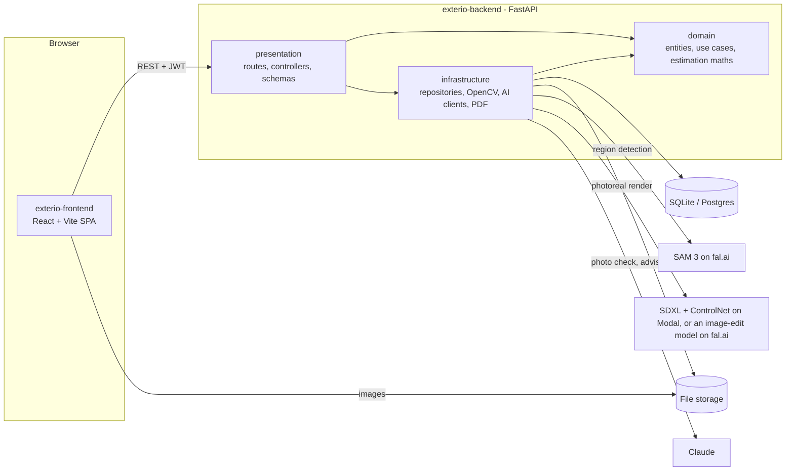

# System Architecture

## The one idea everything hangs on

A photo of a house is turned into a list of **labelled polygons** (wall, window, pillar, railing…).
That single list drives both halves of the product:

```
photo ──> region polygons ──┬──> material preview and photoreal render   (what it will look like)
                            └──> areas ──> quantities ──> cost ──> report (what it will cost)
```

Because the picture and the quote are computed from the same regions, they cannot disagree. A user
who corrects a region corrects the image and the estimate at once.

## Components



| Part | Technology | Responsibility |
|---|---|---|
| `exterio-frontend` | React, TypeScript, Vite, Tailwind, React Query | The five-step studio, region editor, estimate tables |
| `exterio-backend` | Python 3.12, FastAPI, SQLAlchemy | REST API, all measurement and costing logic |
| Imaging | OpenCV, NumPy | Photo quality gate, perspective removal, pixel measurement, material compositing |
| Reporting | pandas, ReportLab | Bill of quantities tables and the PDF |
| Region detection | SAM 3 (text-prompted segmentation) via fal.ai, or a vision LLM when no segmentation model is configured | One polygon per building component |
| Photoreal render | SDXL img2img with a Canny ControlNet on a Modal GPU (`exterio-render/`), or an instruction-based image-edit model via fal.ai | Makes the composited finishes look real |
| Language model | Claude via the Anthropic SDK | "Is this a usable house photo?" check and the material advisor |

Every AI feature is optional. Without keys the API reports the capability as off, the UI hides or
disables it, and the full flow still works with hand-drawn regions and the instant preview.

## Backend layering

The backend follows a clean, layered architecture. Dependencies point inward only.

```
src/
├── bootstrap/        app factory, environment, ASGI entry point
├── presentation/     routes (composition root), controllers, schemas, middleware
├── infrastructure/   repository implementations, OpenCV / AI / PDF / storage services, registry
└── domain/           entities, errors, DTOs, interfaces, pure services, use cases, prompts
```

| Layer | May import | Must not import |
|---|---|---|
| `domain` | itself and the standard library | FastAPI, SQLAlchemy, OpenCV, NumPy, pandas, pydantic, any SDK |
| `infrastructure` | `domain` | `presentation`, `bootstrap` |
| `presentation` | `domain`, `infrastructure` | `bootstrap` |
| `bootstrap` | everything | – |

These rules are **enforced in CI** by `import-linter` (`make boundaries`), not just documented.

Conventions

- **One use case per file**, one public `execute()` method, dependencies injected through the
  constructor as interfaces (`IProjectRepository`, `ISegmentationService`, …).
- **One controller per operation.** Controllers translate HTTP to a use-case call and back. They
  contain no business logic and no error handling.
- **Routes are the composition root.** `presentation/routes/*_routes.py` is the only place use cases
  and controllers are constructed. Concrete infrastructure is built once in
  `infrastructure/registry.py`.
- **Errors.** Use cases raise `DomainError` subclasses with a code such as `PROJECT_001`. A single
  error middleware maps codes to HTTP statuses and produces
  `{ "status": "error", "message": "...", "code": "..." }`.
- **No environment access outside `bootstrap/env.py`.** Configuration reaches infrastructure through
  constructors; the domain never sees it.
- **File naming** mirrors the role: `*_entity.py`, `*_usecase.py`, `*_repo.py` (interface),
  `*_repo_impl.py`, `*_controller.py`, `*_routes.py`, `*_schema.py`.

The estimation maths lives in `domain/services/` as pure functions with no I/O, which is why it can
be unit-tested against hand calculations.

## Frontend layering

```
src/
├── domain/           models and service / repository interfaces (no React)
├── application/      services that implement the interfaces
├── infrastructure/   API repositories and the HTTP client
└── presentation/     features (pages, organisms, hooks, contexts) and shared atoms / molecules
```

Data flows one way: **Component → Hook → Service (from Context) → Repository → HTTP client.**
Components never call the API. Server state lives in React Query.

## AI provider layer

Each AI capability sits behind a small domain interface with exactly one production implementation
and one fake used in tests:

| Interface | Production implementation | Why it is swappable |
|---|---|---|
| `ISegmentationService` | `FalSam3SegmentationService`, then `AnthropicVisionSegmentationService`, chosen by `FallbackSegmentationService` | Model names and prices change often; the first configured provider is used |
| `IPhotorealRenderService` | `ModalPhotorealRenderService` when `MODAL_RENDER_URL` is set, else `FalPhotorealRenderService` | Each one writes the prompt its model understands from the same list of finishes: a short description for SDXL, a full brief for an edit model |
| `IVisionCheckService` | `AnthropicVisionCheckService` | Any vision LLM can answer the same structured question |
| `IAdvisorLanguageModel` | `AnthropicAdvisorLanguageModel` | Generation half of the advisor |
| `IKnowledgeRepository` | `TfidfKnowledgeRepository` | Retrieval half; the seam for an embedding model with pgvector |

Replacing a provider is a one-file change plus one line in the registry.

The Claude-backed services request schema-constrained JSON and also parse the reply leniently,
so they work both against Anthropic's API, which enforces the schema, and against an
Anthropic-compatible gateway that does not (`ANTHROPIC_GATEWAY_URL`).

## Request lifecycle for the slow path

The photoreal render takes 10–30 seconds, so it is not done inside the request:

1. `POST /api/designs/{id}/render` checks the per-user daily cap, marks the design `pending`, and
   returns immediately.
2. A background task calls the image model, pastes the original pixels back outside the edited
   regions, stores the file and marks the design `done` or `failed`.
3. The UI polls `GET /api/designs/{id}`.

If the design is changed while a render is running, the late result is discarded.

Synchronous endpoints are plain functions, which FastAPI runs on a thread pool, so CPU-heavy OpenCV
work and blocking provider calls never stall other users.

## Data model

| Table | Holds |
|---|---|
| `users` | Email accounts and anonymous guest accounts |
| `projects` | Name, owner, and three JSON documents: `image`, `regions`, `scale`, plus `rate_overrides` |
| `designs` | Name, `assignments` (region id → material id), preview and render file paths, render status |
| `render_events` | One row per photoreal request, for the daily cap |

Regions, scale and rate overrides are always read and written together with their project, so they
are stored as JSON on the project row: every save is atomic and needs no joins.

The material catalogue is reference data that ships with the code
(`infrastructure/repository/catalog/materials.json`). A user's rate changes are stored on the
project as overrides and never modify the catalogue.

Ownership is checked in every use case: a project or design that belongs to someone else is reported
as not found.

## Deployment

| Piece | Host | Notes |
|---|---|---|
| Frontend | Any static host (Vercel config included) | `VITE_API_BASE_URL` points at the API |
| API | Any container host (Dockerfile included) | Needs `JWT_SECRET`, `CORS_ORIGINS`, a persistent volume at `STORAGE_DIR` |
| Database | SQLite on the volume, or any Postgres via `DATABASE_URL` | Tables are created at start-up |

## What would change at larger scale

- Background tasks → a job queue with workers (Celery or RQ), so renders survive restarts.
- Local disk → object storage. Only `IFileStorageService` changes.
- `create_all` at start-up → versioned migrations (Alembic).
- TF-IDF retrieval → an embedding model with pgvector, once the knowledge base outgrows keyword overlap.
- The per-user render cap → a proper rate limiter at the edge.
