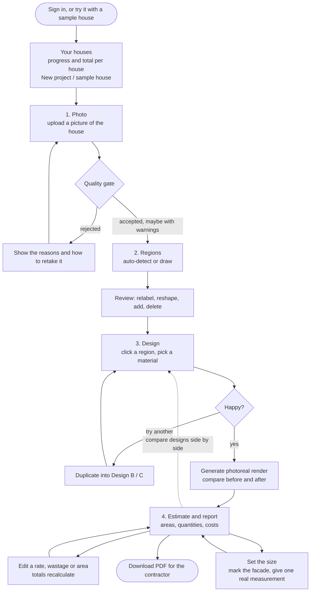

# User Workflow

The product is a four-step studio: Photo, Regions, Design, Estimate. A stepper at the top shows
where the user is; any step can be revisited once a photo exists, and every change is saved to the
project.

The real-world size is not a step. It is only used to turn pixels into square feet, so it lives on
the Estimate page, where its effect is seen: "Adjust size" opens the size view in place, and the
total beside it follows each change. Until a size is given the estimate uses a rough default (a
standard door, or two storeys of 10 ft) and says so with a "Set the size" prompt. Old
`?step=scale` links open that size view.

## What happens at each step

| Step | The user does | The system does |
|---|---|---|
| **1. Photo** | Uploads a JPG, PNG or WebP | Fixes orientation, resizes to a working size, scores sharpness, brightness and resolution, and (if configured) asks a vision model whether it is a usable house exterior. Bad photos are rejected with specific tips. |
| **2. Regions** | Clicks "Auto-detect", then fixes anything wrong | Asks the configured AI provider to outline each component and turns the result into editable polygons. Hand-drawn regions survive a re-run of detection. |
| **3. Design** | Selects a region and a material; saves alternatives as separate designs | Re-renders the instant preview in well under a second. On request, produces a photoreal render in the background. |
| **4. Estimate** | Sees the house with a card per kind of part (finish, size, cost) and a line to each part; opens the full breakdown to edit rates, wastage or an area if they know better. From "Adjust size" (or "Set the size" while the size is a guess), drags four corners onto the main wall and enters a wall size, one known length, a door height, or the number of floors | Removes perspective and converts pixels to feet, with a confidence band per method. Computes net area, wastage, purchase quantity, material and labour cost per line, per category and in total, with a low–high range. Builds the PDF. |

## Design choices made for non-technical users

- **Try it with a sample house.** One button on the sign-in page, with no sign-up. It signs in to
  the shared reviewer account, which already holds a finished sample house; deployments without
  one start a guest session and create the sample house for it first, so either way the first
  screen has a house to open.
- **Steady sign-in form.** The form is anchored to the top, so switching between Sign in and
  Create account never moves the tabs, and the password fields have a show/hide button. Create account asks for the
  password twice and says as soon as the two differ.
- **Sample houses, one at each stage.** The whole flow can be seen without owning a suitable
  photo. Four real photographs are created at different stages, so between them they show every
  step and Your houses shows every kind of progress:

  | Sample | Created with | Opens at |
  |---|---|---|
  | Single-storey ranch | the photo alone | Photo, then Regions for Auto-detect |
  | Two-storey with garage | photo and traced parts | Scale |
  | Brick house with dormers | parts and size | Design, with no finishes yet |
  | Craftsman with stone | a finished design | Estimate |

  The demo account starts with all four; each "try a sample house" adds the next one and opens it
  at its own step. A house opens at the next thing left to do (parts, size, design, estimate).
- **The photo check, the first time.** The first time a browser opens a house that has only its
  photo, the saved photo check is walked through stage by stage over the photo, as right after an
  upload, and then shown. It is remembered per house in the browser, so it plays once; an upload
  in this browser counts as seen, and reduced motion skips it.
- **Before and after on the sign-in page.** Those houses sweep from their photo to their new
  finishes, so the product explains itself before anyone signs in.
- **No feature that cannot work is shown.** When the server has no image model, the photoreal
  render button and tab are hidden rather than shown disabled with an apology.
- **Nothing is a dead end.** If detection misses a pillar, it can be drawn. If no measurement is
  known, a door or floor count still gives an estimate, clearly marked as rougher.
- **Instant feedback first, AI second.** Trying a material is immediate and free. The slower,
  paid AI render is an explicit button, not something that runs on every click.
- **Plain language.** Scale methods are described as "I know the wall size", not by method name.
- **Every number can be questioned.** Each total shows the assumptions behind it, and any area or
  rate can be overridden; overrides are flagged in the report.
