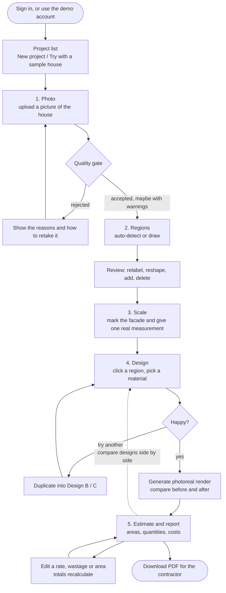

# User Workflow

The product is a five-step studio. A stepper at the top shows where the user is; any step can be
revisited once a photo exists, and every change is saved to the project.

## What happens at each step

| Step | The user does | The system does |
|---|---|---|
| **1. Photo** | Uploads a JPG, PNG or WebP | Fixes orientation, resizes to a working size, scores sharpness, brightness and resolution, and (if configured) asks a vision model whether it is a usable house exterior. Bad photos are rejected with specific tips. |
| **2. Regions** | Clicks "Auto-detect", then fixes anything wrong | Asks the configured AI provider to outline each component and turns the result into editable polygons. Hand-drawn regions survive a re-run of detection. |
| **3. Scale** | Drags four corners onto the main wall and enters a wall size, one known length, a door height, or the number of floors | Removes perspective and converts pixels to feet. Shows how confident the result is for the chosen method. |
| **4. Design** | Selects a region and a material; saves alternatives as separate designs | Re-renders the instant preview in well under a second. On request, produces a photoreal render in the background. |
| **5. Estimate** | Reads the breakdown; edits rates, wastage or an area if they know better | Computes net area, wastage, purchase quantity, material and labour cost per line, per category and in total, with a low–high range. Builds the PDF. |

## Design choices made for non-technical users

- **A demo account.** The sign-in page shows a shared reviewer email and password, and one button
  signs in with them. The account already holds a finished sample house. Deployments without one
  fall back to one-click guest access, so nobody has to register to try it.
- **Steady sign-in form.** The form is anchored to the top, so switching between Sign in and
  Create account never moves the tabs, and the password fields have a show/hide button. Create account asks for the
  password twice and says as soon as the two differ.
- **A sample house.** The whole flow can be seen in under a minute without owning a suitable photo.
- **No feature that cannot work is shown.** When the server has no image model, the photoreal
  render button and tab are hidden rather than shown disabled with an apology.
- **Nothing is a dead end.** If detection misses a pillar, it can be drawn. If no measurement is
  known, a door or floor count still gives an estimate, clearly marked as rougher.
- **Instant feedback first, AI second.** Trying a material is immediate and free. The slower,
  paid AI render is an explicit button, not something that runs on every click.
- **Plain language.** Scale methods are described as "I know the wall size", not by method name.
- **Every number can be questioned.** Each total shows the assumptions behind it, and any area or
  rate can be overridden; overrides are flagged in the report.
